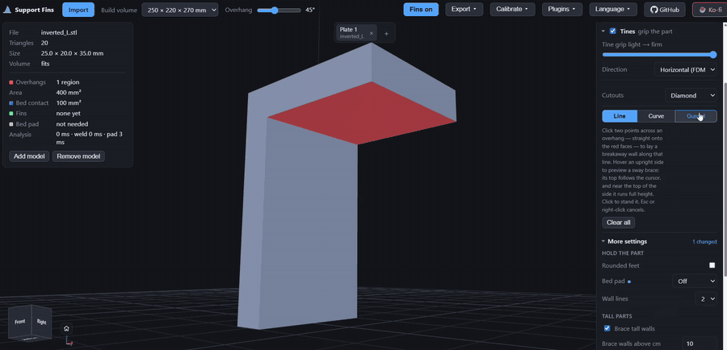
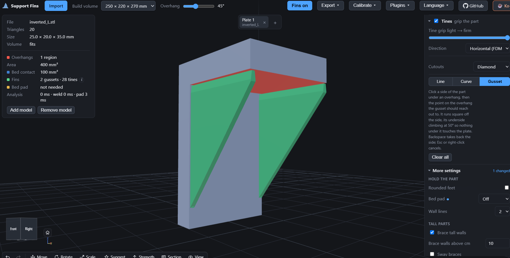
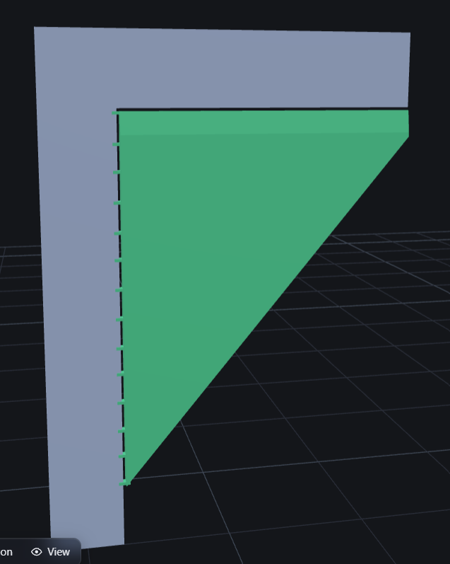
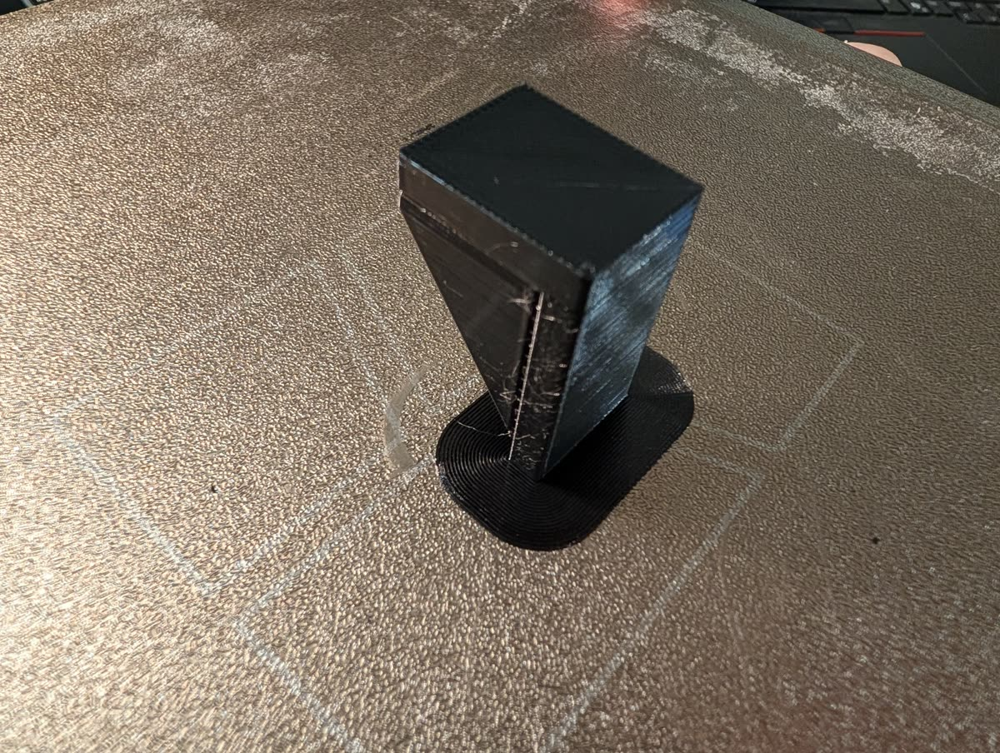

# Support Fins

**Tip a part on edge, and Support Fins adds the breakaway support fins that make that
orientation printable — baked right into the STL.**

Live at **[printfins.com](https://printfins.com)**. Runs entirely in your browser: nothing
uploads, nothing installs, no account.

## Why

Printing a part flat is usually the weakest way to print it. Lying or diagonal layer
orientation tests up to ~3× stronger than standing up. Most people print flat anyway,
because the strong orientation needs supports, and slicer supports scar the surface, waste
plastic, and take longer to pick off than the part took to design.

Designed-in fins fix that, and they beat slicer supports in one way a slicer can't touch:
the support lives in the STL. Upload it anywhere — any printer, any filament, any slicer —
and it still comes out right. A slicer only ever outputs gcode for one machine.

No slicer generates these. OrcaSlicer's whole style list is Grid / Snug / Organic / Tree
Slim / Strong / Hybrid, and none of them modify the mesh or bond to the part on purpose.
The technique isn't new (Slant3D has evangelized designed-in supports for years), but until
now you had to CAD it by hand every time.

## How it works

1. Import an STL, 3MF, STEP or OBJ.
2. Rotate it. You're in control — Support Fins suggests, it never decides for you.
3. It shows you live: overhang count, how many can take a real fin, height, bed contact.
   Point at the load direction, answer one question — _does it pull apart, or does it
   lever?_ — and it scores orientations for strength too.
4. Export. Fins and a bed pad come baked into the STL (or 3MF).

**Why you pick the rotation, not the software:** "stronger" means nothing without a load
direction, and the geometry doesn't contain one. Turn a solver fully loose and it'll hand
you a part 155 mm tall balanced on a needle with two sail-sized fins — technically optimal,
completely unprintable. (Ours did exactly that.) So the human makes the one call the
software can't, and the software does the rest.

## Status

The web app is live and does the full loop: load, rotate, score, fin, export. The geometry
engine is validated against third-party STLs and pinned by an offline test suite.

Working: overhang detection, bed-reachability, contoured breakaway fin walls, orientation +
load-direction scoring, the combined fin (wall + tines that fuse into the part — the whole
point; see `docs/FIN-SPEC.md`), optional sway braces that tie tall parts' sides on all
the way up (auto, or click an upright side in Draw), hand-placed gussets that stand off
an upright side to hold up an overhang above it, STL, 3MF, STEP and OBJ import, STL and 3MF export.

Still open: scale-aware fin profiles, and the bed pad on tilted exports.

### Nozzle size and wall lines

Set **Nozzle** (0.2–2.0 mm) to your printer's nozzle and the support widths follow it;
**Wall lines** (2 / 4 / 6 / 8) makes walls, wedges and sway braces thicker for tall parts.
The contact tip and tines stay one line wide either way. See
[the nozzle guide](docs/NOZZLE.md) for the sizes and what to check in the slicer.

### Rounded support feet

**Rounded feet** optionally rounds the corners of FDM bed-standing wall,
squat, wedge and Sway feet inside their existing clearance envelope. It starts
off, so existing geometry stays unchanged. Vertical/resin pin mode keeps its own
windowed/undercut feet, even if the setting is saved as on. The choice is undoable and saved in
3MF sessions. Engine callers opt in with `tunables: { roundFeet: true }`;
direct Sway callers use `roundFeet: true`. Omitted/false restores ordinary feet.
Segment joints overlap inside the foot contour rather than meeting face to face.
Rounding removes corner area; plate adhesion and tall-print stability have not
been physically compared. Check the sliced first layers and print-test before
using it for tall parts.

### Sway braces for tall parts

**Full brace depth** is an optional checkbox under Sway. It starts off, keeping
the usual 60 mm depth limit. On, **Brace depth** uses its selected 5–50% of the
actual brace height beyond that limit: a 999 mm brace at 15% reaches about 150 mm.
The wider foot needs more plate space and material; model/support collisions can
still shorten or refuse a brace. Check the build-volume preview and sliced first
layers. Thickness, contact tines and grip rules are unchanged; deeper metre-high
braces have not been physically print-tested. Undo/redo and 3MF sessions retain
the checkbox. Direct callers opt in with `sway: { on: true, uncappedDepth: true }`.

Tall, slender parts have a problem the fins were never built for: nothing overhangs, but
as the part grows, the nozzle's drag and each layer shrinking as it cools push the top
around. The part drifts, sags or wobbles, and every movement shows up as a layer line.
Sway braces stop that by tying the part's upright sides to a stiff support all the way up.

**What a sway brace is:** a vertical rib standing **edge-on** to an upright side (its stiff
direction). It's deep at the bed and tapers to a 4 mm flat top, gets thicker as it gets
taller, and sits on a thin foot on the plate. One-layer horizontal tines, spaced **evenly
up the full height**, tie it to the part. Like every support here, it stands off by the
breakaway gap and snaps off; only the tines touch the part.

**Using it:** tick **Sway braces (tall parts)** in the options panel. It's off by default.

- **Auto** braces the tallest sides for you: up to four faces facing different ways, so
  both axes are held, with each rib placed where its face reaches highest.
- **Draw**: one click on an upright side stands a brace there. Click a support you placed
  to select it (amber), then press **Delete** or **Remove selected**; Undo brings it back.
- Three settings appear while it's on: **Brace grip from** (height the tines start;
  0 = the whole height), **Brace tine spacing** (default 6 mm) and **Brace depth**
  (% of height at the bed; default 15%).
- Braces keep at least 1 mm of air between them. One that would run into another,
  for example straight across a narrow channel, is refused with a reason rather than
  fused into a bar that won't break away.

**Why this shape, not the old Brace fin:** the Brace fin lies flat against the face, so it
bends the easy way exactly when the part leans into it, and its tines bunch at the base
and spread out going up, leaving the top of a tall part, where the sway is, nearly
untied. Every number and the reasoning behind it is in `docs/FIN-SPEC.md` ("Sway
braces"); the code is `web/sway.js`, and `tests/sway.test.js` pins its behaviour.

**Status: printed.** Developed on a 249 mm fence-post cap, where Auto places 4 braces
(about 20 g of support) and hand-placed braces follow its gable up to 225 mm. Two test
prints (2026-09-22) both came out clean, so the defaults below — depth, thickness and
tine spacing — are the printed ones, not estimates.

### Gussets: fins off a side of the part

Some overhangs have nothing under them but more part, like the arm of an upside-down L.
A plate fin can't reach it without standing in the way, and the overhang is often too
far from the bed to be worth a tall wall anyway. A **gusset** comes off the upright side
instead. It is a wedge-shaped fin whose underside climbs at 50° from level, so it
prints without support of its own, and whose top holds up the overhang.



**Using it:** in **Draw**, pick **Gusset** (next to Line and Curve). Click the upright side
under the overhang, then click the point on the overhang the gusset should reach out to.
It always runs square off the side. The second click only sets how far it reaches, and the
preview shows it before you commit. Backspace takes back the first click; Esc or a right
click cancels. Place as many as you like, side by side.



**How it holds on:**

- **Side tines, always.** One-layer tines tie the gusset's inner edge to the side, with one
  in its very first layer (so it never starts printing in air), one in its top layer, and
  the rest at most 2 mm apart. They're built even with Tines off.

  

- **Top tines** bite into the overhang when its underside is sloped and Tines is on. A flat
  ceiling gets none (horizontal tines have nothing to bite), so the gusset stops 0.2 mm
  short and the ceiling's first layer bridges onto it, like any other fin.
- Like every support here, it stands off the part by the breakaway gap, and only the
  tines touch it.

Its top follows whatever it holds up: a sloped or round underside (a boss through a
wall, say), or a groove or step in it, which the gusset bridges under.

A gusset is refused, with the reason, if the side isn't solid where its tines go, if the
reach is too short, if it would run into the part, or if it would touch another support
(the two would fuse into one piece).



**Status: printed once.** Tested on a 25 × 20 × 35 mm upside-down L (2026-10-28) with
default settings. The angle, gap and tine spacing are the starting values, not tuned
from prints yet. The numbers and reasoning are in `docs/FIN-SPEC.md` ("Gussets"), the
code is `web/gusset.js`, and `tests/gusset.test.js` pins its behaviour.

#### Hoops: a gusset round an overhang's edge

A straight gusset runs square off the side, so under a rounded tab with a screw hole
in it, it would run straight under the hole. A **hoop** follows the overhang's edge
instead: out from the side along one edge, round the end and back to the side,
leaving the middle (and the hole) open.

**Using it:** in **Draw**, pick **Hoop**. Click the side under the overhang, then click
the overhang. The hoop finds the overhang's edge by itself and runs just inside it.
A tab on a lip works too, like an eyelet sticking out of a rim inside a tube: the hoop
goes round the eyelet, then runs straight across under the lip to the wall, curved
or not.
Both of its ends are tined to the side, the same way a gusset's inner edge is, with
Tines on or off. Its underside climbs at the gusset angle along the hoop from each end,
so it's deepest where it meets the side and shallowest halfway round. It keeps clear
of the part and of other supports the same way a gusset does.

A hoop is refused, with the reason, if there's no overhang between the tab and the side
you clicked (use a gusset there), or for any of a gusset's reasons.

**Status: not printed yet.** The code is `web/hoop.js`, and `tests/hoop.test.js` pins its
behaviour on a plate with a rounded, holed tab (`hoop_tab.stl`), a tube with eyelets
on its inner lips (`eyelet_rim.stl`), and a tube with a round boss through its wall
(`boss_tube.stl`).

#### Gussets and hoops in Auto

Auto can place gussets and hoops itself. Under **More settings › Auto can use**, tick
**Gussets** and/or **Hoops** (both off by default, so Auto doesn't change until you do).
Auto then:

- keeps its short walls from the plate: they're sturdy and don't mark the side;
- swaps a tall wall for gussets when the wall is at least 3 times as tall as the gussets
  and they hold the same overhang, like a 69 mm wall from the plate under a boss half
  way up a tube;
- puts gussets under overhang no wall reached, like a tab sticking out of a side with
  nothing under it, or anything over the part with **Plate only** ticked;
- uses a hoop where the overhang has a hole in it, or where a gusset won't fit.

**Straight walls** and **Curved walls** are in the same group: untick Straight walls to
leave everything to the curves, gussets and hoops. The readout counts the gussets
apart from the walls. The rules and numbers are in `docs/FIN-SPEC.md` ("Auto can use"),
the code is `web/fins/gussets.js`, and `tests/autogusset.test.js` pins it on the three
test parts. **Not printed yet.**

#### Fill an overhang (paint bucket)

In **Draw**, pick **Line**, **Curve**, **Gusset** or **Hoop**, then turn on **Fill an
overhang** (the paint bucket under them). Hovering a red overhang lights all of it; a
click fills it with every support of that shape that fits, placed the way Auto would
place them under that one overhang. Each lands as an ordinary drawn support, so you can
click one to select it and remove it, and one Undo takes back the whole fill. A small
bore that Auto leaves bare on purpose is filled too when you click it. If nothing of
that shape fits (a gusset with no upright side under the overhang, a hoop with no hole
or edge to follow), the readout says so. Click the button again to go back to placing
one at a time. The code is `web/fins/bucket.js`, tested in `tests/bucket.test.js`.

### Section view: cut across an axis

The **Section** badge under the view cuts the part with a plane, so you can see and
draw inside it. Its popover now also has **Cut across X / Y / Z**, which squares the
cut to one of the bed's axes and keeps the half away from you, and a slider that slides
the cut from one end of the part to the other, with the distance in mm. **Ghost** shows
the cut-away half as faint glass, **Hide** leaves it out, and the arrow, rings, sheet
and Shift + scroll still move the cut as before. It only changes the view: the export
is always the whole part.

### The "no config, geometry only" notice

Opening the 3MF, **Bambu Studio** ("invalid config, load geometry data only") and
**PrusaSlicer** ("does not contain PrusaSlicer configuration. Only geometry was
loaded.") show a notice and import just the mesh. This is **expected and harmless** —
every slicer shows it for any geometry-only 3MF (Fusion 360, FreeCAD, even the 3MF
Consortium's own reference files). The part imports correctly oriented and sized; the
fins come in as intended. Just slice with supports off. (OrcaSlicer opens it without a
notice.)

The export ships **pure geometry with no slicer profile embedded** on purpose: baking
in a profile would silence the notice but replace whoever-opens-it's printer/filament/
print settings with ours on load, and it would have to be re-authored per slicer _and_
per slicer version — a worse trade than a one-time, benign notice on a file whose
geometry is already right. See `web/threemf.js` for the writer.

## Run it locally

The web app is vanilla ES modules — no build step. Serve it with the included dev server
(it disables caching so edits actually show up on reload):

```bash
python3 dev-server.py                      # http://localhost:8731/
python3 dev-server.py 8080                 # custom port
python3 dev-server.py --host 0.0.0.0       # reach from other devices on the LAN
```

By default the server binds to `127.0.0.1` (localhost only). Pass `--host 0.0.0.0`
to expose it to the local network — handy on a headless box like a Raspberry Pi
behind a firewall; the script prints the LAN address to open. The port is an
optional positional argument and `--help` lists every option.

### Run with Docker

```bash
docker compose pull web
docker compose up -d        # http://localhost:8731/
```

This uses the latest stable release by default.

To pin a release, add this to a `.env` file beside `docker-compose.yml`:

```env
SUPPORT_FINS_VERSION=v1.0.0
```

To build the checked-out source instead:

```bash
docker compose up --build
```

The Python prototype is the proof of concept the engine was ported from — plain mesh math,
no CAD kernel:

```bash
pip install trimesh numpy manifold3d
python3 prototype/spike_overhangs.py yourpart.stl      # what needs support
python3 prototype/spike_fins.py yourpart.stl out.stl   # add fins
python3 prototype/spike_orient.py yourpart.stl         # rank orientations
python3 prototype/spike_arrow.py yourpart.stl 0,0,-1   # load-direction scoring
```

Tests (Deno for the JS engine):

```bash
deno test --allow-read tests/
```

### Releases

`main` is staging: once Cloudflare deploys the `live` branch, every merge shows up at the
`main` preview, not on printfins.com.
A PR that changes what a user sees adds one line to `unreleased` in `web/changelog.json`.
To ship, run Actions > release > Run workflow (version empty for the next patch, or say
`1.1.0`). It stamps everything unreleased under that version, writes the landing card's
What's new list into `web/index.html`, runs the tests and pushes that as one release
commit to `main`; then it tags it, moves the `live` branch printfins.com deploys from,
attaches the plugin builds and publishes the Docker image. Fix an entry's wording on `main`
before you run it. Releases are on the
[Releases page](https://github.com/gittrahan/support-fins/releases) and the site's landing card.

## The PrusaSlicer plugin (hand-placed)

`plugins/prusa/` is a native PrusaSlicer 3.0 plugin, **Support Fins → Add a Fin**. The 3.0
plugin sandbox can't read a loaded mesh's triangles, so it can't do the automatic tool. It
drops one angled-print support fin instead: a thin triangle whose slope you set 0.2 mm under
a tilted part's underside, with one-layer tines along it (Slope Angle, Fin Height, Tine
Spacing). You place it by hand; size it with Fin Height rather than the slicer's scale tool,
which would stretch the one-layer tines. Confirmed working in PrusaSlicer 3.0 alpha11
(2026-10-02). For fins shaped to the part automatically, use the browser app. See `plugins/prusa/README.md`.

## Honest limitations

- Overhangs sitting over the _part_ rather than the plate aren't handled automatically.
  Fins attach to the bed, and a gusset off an upright side has to be placed by hand.
- Features shorter than roughly a 4 mm wall height are too short for a real fin.
- It won't pick your orientation for you. On purpose.

## Layout

```
web/         the browser app (live at printfins.com)
plugins/     slicer/CAD integrations (PrusaSlicer, OrcaSlicer, Onshape, Autodesk Fusion), the
             command line, and an MCP server for AI clients
prototype/   Python/trimesh proof of concept the engine was ported from
docs/        FIN-SPEC.md — the verified fin geometry, with sources; PLUGIN-CONFIG.md —
             every plugin setting (Orca config keys, CLI flags)
tests/       offline geometry regression suite
```

Fins are separate closed solids appended to the mesh; the slicer unions them. The whole
engine is plain mesh math with no boolean kernel, because it has to run in the browser.

## Credit

The fin technique is Slant3D's — they've evangelized designed-in supports for years.
Support Fins just automates it. `docs/FIN-SPEC.md` cites their numbers directly.

## License

MIT. The license covers this tool, not what you make with it — STLs you run through Support
Fins are entirely yours, and the output carries no license obligation.

STEP import uses [occt-import-js](https://github.com/kovacsv/occt-import-js) (Open CASCADE
compiled to WebAssembly), vendored unmodified under `web/vendor/occt-import-js-0.0.23/` with its
LGPL-2.1 license files. The browser only downloads it when you go to import a file.

Pointer picks on dense parts use [three-mesh-bvh](https://github.com/gkjohnson/three-mesh-bvh),
vendored unmodified under `web/vendor/three-mesh-bvh-0.9.15/` with its MIT license.

---

Free and open source. If it ever saves you a print, you can [buy me a coffee on
Ko-fi](https://ko-fi.com/matthewtrahan) ☕.
